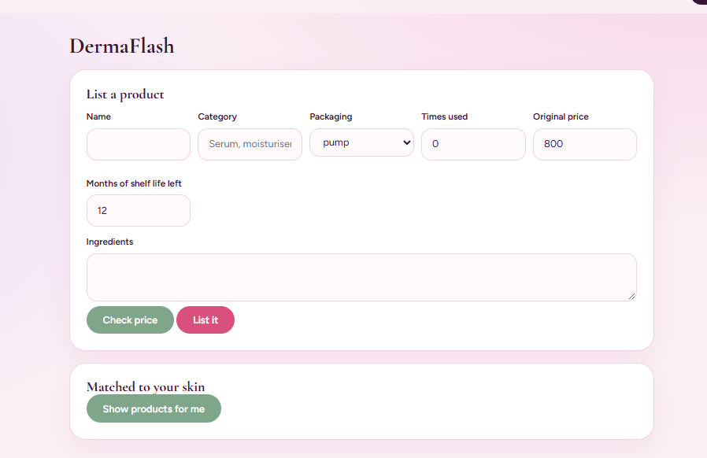

=> DermaSense: Skincare that actually knows your skin

DermaSense is a full-stack web app that scans your face, checks any ingredient list before you buy, soothes bad reactions with home remedies, and lets users pass unsuitable products on to someone they'll suit.

> **Project note:** DermaSense is my own individual, simplified version of a concept from a four-person team project I took part in. The idea and feature set originated in that team project; this implementation was built by me with AI assistance

> Disclaimer: DermaSense gives general skincare guidance, not medical advice. The skin analysis is a heuristic estimate, not a diagnosis.

> Features

-  Skin scan: upload a front-facing daylight photo and get an estimate of skin tone, skin type, face shape and concerns (acne, dark spots, redness). Uses MediaPipe Face Mesh and OpenCV colour analysis. You can fine-tune the profile (skin type, concerns, allergies, ingredients to avoid) and build a morning and night routine.
-  Product check: paste an ingredient list or **upload a label photo (EasyOCR)** to get a 0-100 suitability score with reasons. A "Do my products clash?" tool flags ingredient combinations that shouldn't be used together.
- Skin SOS: describe a reaction and the product that caused it. Get gentle home remedies, a "stop using this product" warning, ingredients to avoid, and signs it's time to see a doctor.
- DermaFlash: a safe resale marketplace for unsuited products. It has hygiene-based eligibility rules (no eye or lip products, no used jars, limited uses, minimum shelf life), automatic fair-price suggestions, and listings matched to your skin profile.
- Authentication: signup and login with salted PBKDF2-SHA256 password hashing and token-based sessions (SQLite).

> Tech Stack

| Layer | Technology |
|---|---|
| Backend | Python, FastAPI, Uvicorn, Pydantic |
| Computer Vision | OpenCV, MediaPipe, NumPy |
| OCR | EasyOCR |
| Database | SQLite |
| Frontend | HTML5, CSS3, vanilla JavaScript |

> Screenshots

| Landing page | How it works |
|---|---|
|  |  |

| Skin scan | Product check |
|---|---|
|  |  |

| Skin SOS | DermaFlash |
|---|---|
|  |  |

> Project Structure

```
dermasense/
├── backend/
│   ├── main.py              # FastAPI app (also serves the frontend)
│   ├── routes/              # auth, skin, product, remedies, resale
│   ├── services/scoring.py  # ingredient scoring engine
│   └── data/                # ingredient and remedy knowledge base
├── frontend/
│   ├── index.html, scan.html, check.html, sos.html, flash.html
│   ├── login.html, signup.html
│   ├── css/style.css
│   └── js/
└── screenshots/
```

> API Endpoints

| Method | Endpoint | Purpose |
|---|---|---|
| POST | `/api/auth/signup`, `/api/auth/login` | Register and log in |
| GET | `/api/auth/me` | Current user |
| POST | `/api/skin/analyze` | Skin analysis from image |
| POST | `/api/product/analyze` | Score a product's ingredients |
| POST | `/api/product/ocr` | Extract ingredients from a label photo |
| POST | `/api/conflicts` | Detect ingredient conflicts |
| POST | `/api/routine` | Build AM/PM routine |
| GET | `/api/remedies` | Remedies for a skin reaction |
| POST | `/api/listings`, `/api/price-estimate`, `/api/listings/match` | DermaFlash marketplace |

> Getting Started

```bash
git clone https://github.com/iam-alen/dermasense.git
cd dermasense/backend
python -m venv venv
venv\Scripts\activate           # macOS/Linux: source venv/bin/activate
pip install -r requirements.txt
uvicorn main:app --reload
```

Open **http://localhost:8000**. The backend serves the frontend, and API docs are at `/docs`.
Requires Python 3.9-3.12 (MediaPipe compatibility).

> Roadmap

- Train a CNN on a dermatology dataset for the skin scan
- Persist marketplace listings in the database
- Session expiry, rate limiting, restricted CORS
- Docker setup and cloud deployment

> Author

**Alen**: [GitHub](https://github.com/iam-alen) · [LinkedIn](https://www.linkedin.com/in/your-profile)

Built individually with AI assistance, based on a concept from a team project.
